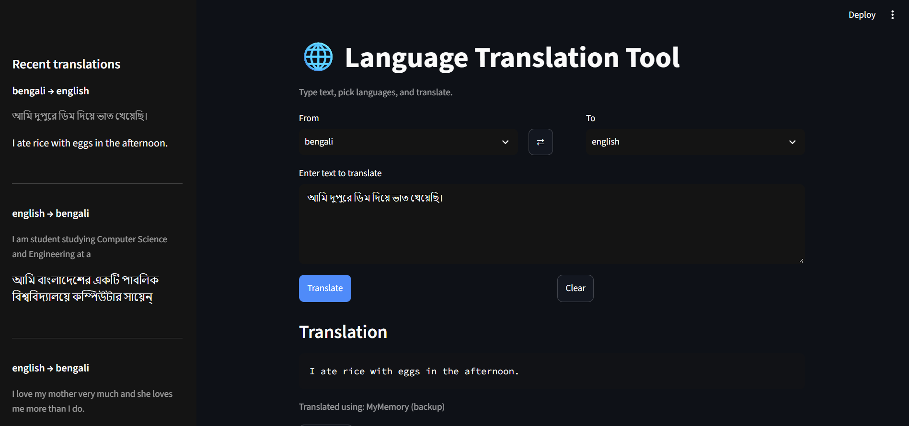

# CodeAlpha_TranslationTool

A language translation web app built with Python and Streamlit, created for the
CodeAlpha Artificial Intelligence internship (Task 1).

## Features
- Enter text and choose source and target languages (100+ supported, plus auto-detect)
- Translation through Google Translate, with automatic fallback to MyMemory
- Warning when the output may be in the wrong language
- Copy button, text-to-speech, language swap, clear button
- History of recent translations

## How it works
1. The user enters text and picks languages in the Streamlit interface.
2. The text is sent to a translation service through the `deep-translator` library.
3. If the first service fails, the app retries and then falls back to a second one.
4. The result is displayed, and can be copied or played as audio (gTTS).

## Installation
```
git clone https://github.com/SeheleeHossain79/CodeAlpha_TranslationTool.git
cd CodeAlpha_TranslationTool
python -m venv venv
venv\Scripts\activate
python -m pip install -r requirements.txt
python -m streamlit run app.py
```

## Tech stack
Python, Streamlit, deep-translator, gTTS, langdetect

## Limitations
The free translation services are less accurate than the official paid APIs,
especially for idioms. A future improvement is the Google Cloud Translation API.

## Screenshot
